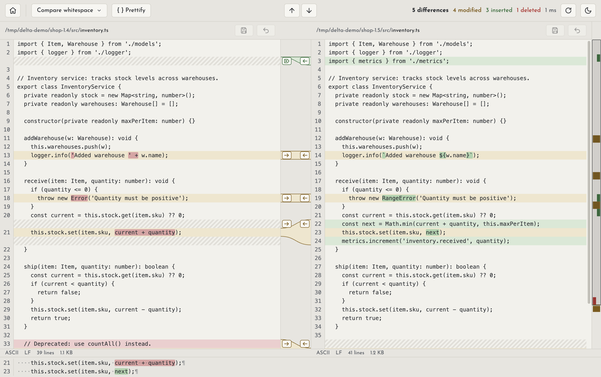
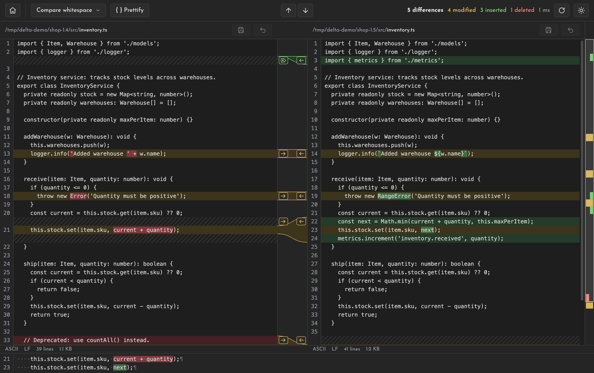
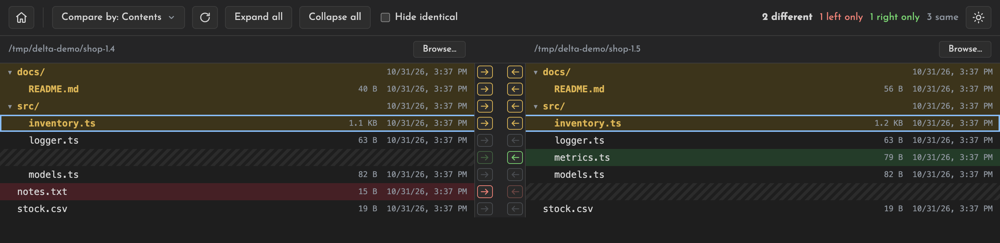
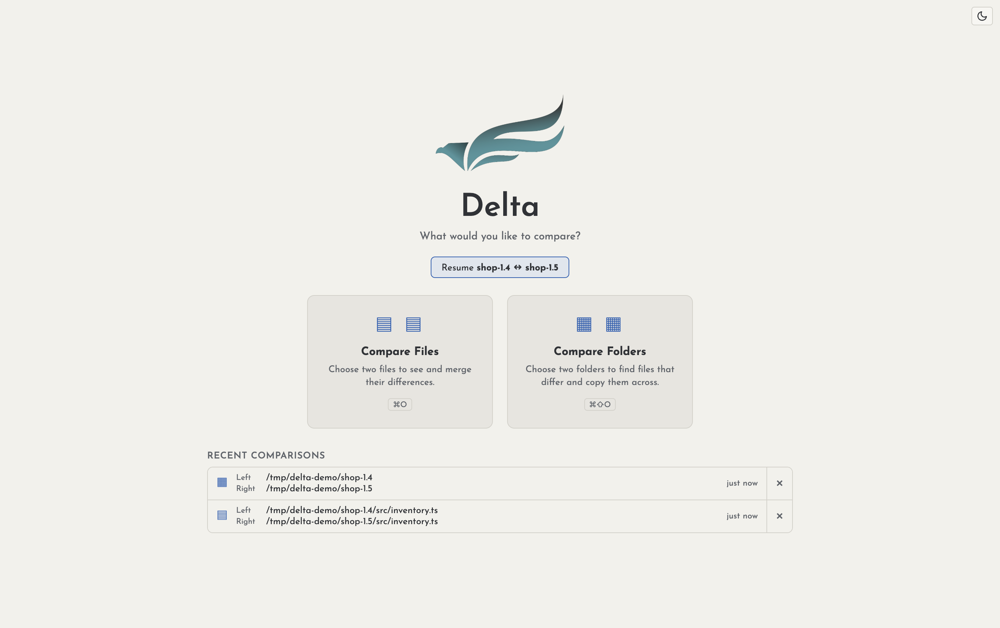

<p align="center">
  
</p>

<h1 align="center">Delta</h1>

A fast, friendly app for comparing and merging text files and folders. Desktop app for macOS, Windows and Linux, or in your browser.

Delta shows two text files or two folders side by side and makes their differences easy to read, review and merge. Edit either side right in the comparison, copy changes across with one click, and save.

## Quick Start

You need [Node.js](https://nodejs.org/) 22.12 or newer. Then, for the **browser version**:

```sh
git clone <this repository's URL> delta
cd delta
./start.command          # or double-click start.command (macOS) / start.cmd (Windows)
```

The first start installs what Delta needs and builds it (about a minute); then your browser opens Delta at http://localhost:5910.

For the **desktop app** instead: `npm install`, then `npm start`.

Both forms, updating and troubleshooting are covered in [Installing and running](docs/installing.md).

## Screenshots









## Documentation

| Page | What it covers |
|---|---|
| [Features](docs/features.md) | Comparing files, editing and merging, comparing folders |
| [Installing and running](docs/installing.md) | Desktop app and browser version, updating |
| [Troubleshooting](docs/troubleshooting.md) | Common start-up problems |
| [Logs](docs/logging.md) | Where logs are kept and how to turn on debug logging |
| [Keyboard shortcuts](docs/keyboard-shortcuts.md) | Shortcuts for both versions |
| [How the diff works](docs/how-the-diff-works.md) | The comparison engine and its performance |
| [Development](docs/development.md) | Commands, project structure and what Delta is built with |

## License

Delta is released under the [MIT License](LICENSE.md). Bundled third-party assets are listed in [THIRD_PARTY_NOTICES.md](THIRD_PARTY_NOTICES.md).
