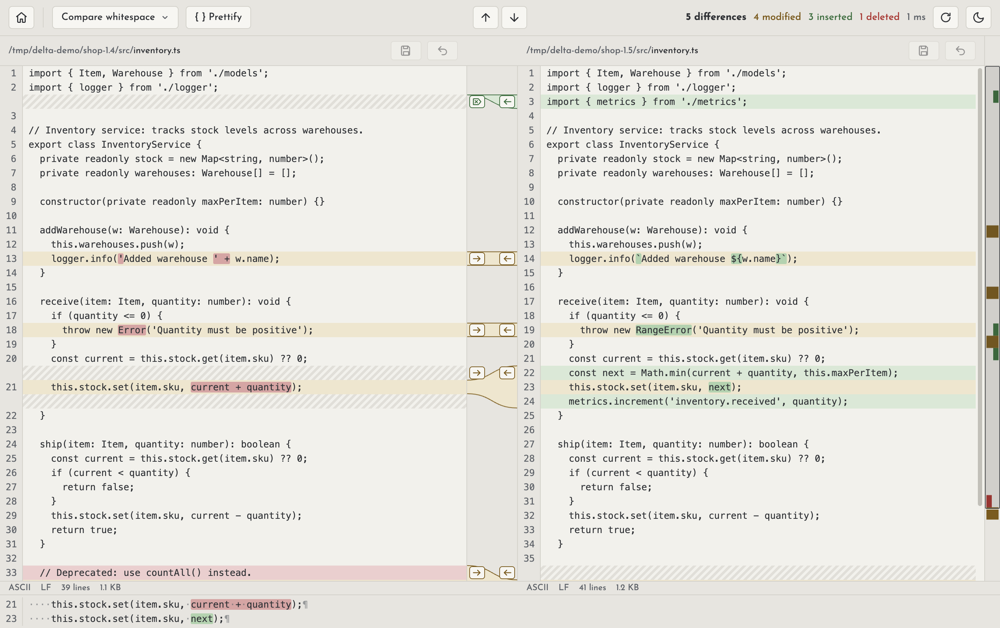
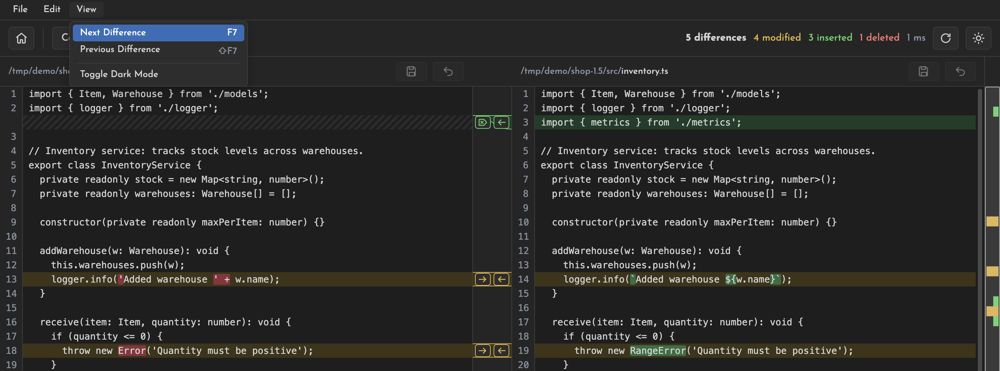
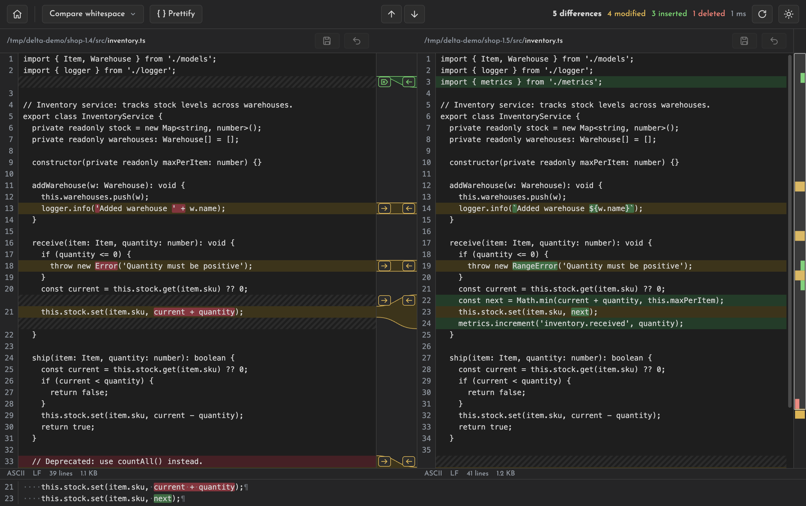
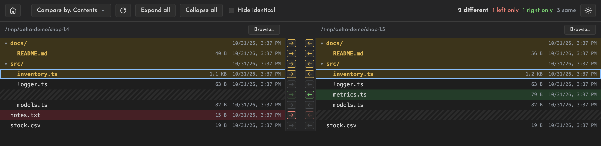
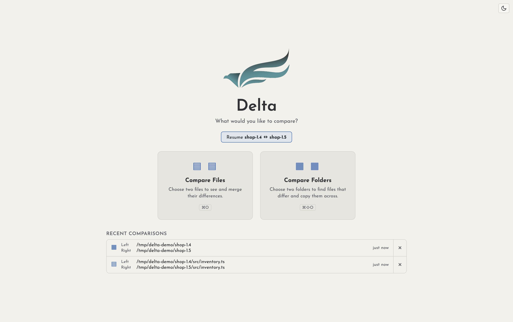

<p align="center">
  
</p>

<h1 align="center">Delta</h1>

<p align="center">
  A fast, friendly app for comparing and merging text files and folders.<br>
  Desktop app for macOS · Windows · Linux, or in your browser
</p>

<p align="center">
  <a href="LICENSE.md">MIT License</a> ·
  <a href="THIRD_PARTY_NOTICES.md">Third-party notices</a>
</p>

---

Delta shows two text files or two folders side by side and makes their differences easy to read, review and merge. Edit either side right in the comparison, copy changes across with one click, and save.



## Quick start

You need [Node.js](https://nodejs.org/) 22.12 or newer. Then, for the **browser version**:

```sh
git clone <this repository's URL> delta
cd delta
./start.command          # or double-click start.command (macOS) / start.cmd (Windows)
```

The first start installs what Delta needs and builds it (about a minute); then your browser opens Delta at http://localhost:5910.

For the **desktop app** instead: `npm install`, then `npm start`.

The next section explains both in more detail.

## Installing and running

Delta comes in two forms built from the same code. Pick whichever suits you; they share your list of recent comparisons.

| | Desktop app | Browser version |
|---|---|---|
| What it is | A regular app with its own window | A small local server, used in your web browser |
| Install | Build an installer once (`.dmg`, `.exe`, AppImage) | Nothing to install beyond Node.js |
| Start it | From your Applications folder or Start menu | `start.command` (macOS, Linux) or `start.cmd` (Windows) |
| Best for | Everyday use | Trying Delta, or machines where you'd rather not install apps |

### 1. Prerequisites

- **[Node.js](https://nodejs.org/) 22.12 or newer.** Check with `node --version`. The LTS installer from nodejs.org is fine; Homebrew, nvm and Volta installs work too.
- **Git**, to clone the repository (or download it as a ZIP from GitHub and unzip it).
- macOS, Windows or Linux.

### 2. Get the code

```sh
git clone <this repository's URL> delta
cd delta
```

### 3a. The browser version

Delta's browser version runs a small server on your own computer (`127.0.0.1` only, never on the network) that does the file access, and shows the same interface as the desktop app in your browser.

**Start it:**
- **macOS:** double-click **start.command** in the project folder (or run `./start.command` in Terminal).
- **Windows:** double-click **start.cmd** (or run `start.cmd` in a Command Prompt).
- **Linux:** run `./start.command`.
- **Anywhere:** `npm run web` does the same.

The first start installs Delta's dependencies and builds it, which takes a minute; later starts take a second or two. It also reinstalls or rebuilds by itself after you update the code. Your browser then opens Delta at **http://localhost:5910**; open as many tabs as you like. Delta keeps running in that window: press **Ctrl+C** there, or close the window, to stop it.

**Start with a comparison:** pass two files or two folders.

```sh
./start.command left.txt right.txt
./start.command ~/project-v1 ~/project-v2
```

**Stop or restart it:** press Ctrl+C in its window, or from any terminal:

```sh
./start.command --stop       # stop the running copy
./start.command --restart    # stop it and start again (after updating, say)
```

On Windows use `start.cmd --stop` / `start.cmd --restart`; with npm, `npm run web -- --restart`.

Only one copy runs per port: starting Delta again while it's running (with or without paths) opens the running one in your browser, with the new comparison if you gave one. To use another port, add `--port <number>`.

One thing differs from the desktop app: Cmd/Ctrl+W, T and N stay with the browser.

**Security:** the server listens on your computer only (`127.0.0.1`), never on the network, and accepts file requests only from Delta's own page, so other websites you visit can't reach your files through it. Like any local web app, it trusts programs already running on your computer.



### 3b. The desktop app

First install the build tools (including Electron) into `node_modules/`; this takes a minute or two:

```sh
npm install
npm rebuild electron    # only if you've already used the browser version, which skips Electron's app download
```

**Run it straight from the project:**

```sh
npm start        # build into dist/app/ and open Delta
```

(`npm run dev` also opens the desktop app, but it's for working on Delta's code: a development build that reloads as you edit. See [Development](#development).)

**Or build an installer and install Delta like any other app:**

```sh
npm run dist     # creates installers for your platform in dist/installers/
```

| Platform | What you get | How to install |
|---|---|---|
| macOS | `Delta-<version>-<arch>.dmg` and `.zip` | Open the `.dmg` and drag Delta to Applications |
| Windows | `Delta Setup <version>.exe` and a portable `.exe` | Run the setup program, or run the portable `.exe` directly |
| Linux | `Delta-<version>.AppImage` | `chmod +x Delta-*.AppImage`, then run it |

The installers aren't code-signed, so the first launch needs one extra step:
- **macOS:** right-click Delta in Applications, choose **Open**, then **Open** again. After that it opens normally.
- **Windows:** if SmartScreen appears, choose **More info**, then **Run anyway**.

To build for a particular platform, use `npm run dist:mac`, `dist:win` or `dist:linux` (Windows and macOS installers are best built on those systems).

**Opening a comparison from a terminal:** pass two files or two folders.

```sh
open -a Delta --args left.txt right.txt                 # macOS
"C:\Program Files\Delta\Delta.exe" left.txt right.txt   # Windows (default install location)
./Delta-*.AppImage ./before ./after                     # Linux
```

### Updating

```sh
git pull
```

**Browser version:** start it as usual (or `./start.command --restart` if it's running). It notices the new code, reinstalls dependencies if they changed, and rebuilds itself.

**Desktop app run from the project:** `npm install`, then `npm start` (which rebuilds as it opens).

**Installed desktop app:** there's no automatic update; build a new installer and install it over the old one. Your recent comparisons and settings are kept, since they live in your user settings folder, not in the app.

```sh
npm install      # picks up any changed dependencies
npm run dist     # new installer in dist/installers/
```

- **macOS:** quit Delta, open the new `.dmg` and drag Delta to Applications, choosing **Replace**. The first launch may need right-click > Open again, because each build is a new (unsigned) app.
- **Windows:** quit Delta and run the new `Delta Setup <version>.exe`; it upgrades the existing installation (no need to uninstall). For the portable version, replace the old `.exe` with the new one.
- **Linux:** replace the old AppImage with the new one (and `chmod +x` it).

### Troubleshooting

- **"Delta needs Node.js 22.12 or newer"**, or npm warns about an unsupported engine: install a current Node.js from [nodejs.org](https://nodejs.org/) and start Delta again.
- **"A Delta started before an update is still running on port 5910"**: a copy from before you updated is still running and can't take over. Run `./start.command --restart` (or `start.cmd --restart`, or `npm run web -- --restart`).
- **"Port 5910 is already in use by another program"**: something else is using that port. Stop it, or start Delta on another one: `./start.command --port 5920`.
- **macOS won't open start.command** ("cannot be opened because it is from an unidentified developer", typically after downloading the project as a ZIP): right-click it, choose **Open**, then **Open** again. Or run `./start.command` in Terminal. If it says "permission denied", run `chmod +x start.command` once.
- **Ctrl+C doesn't stop it straight away while it's installing**: npm first undoes the half-finished install, which waits for downloads in progress. Delta says so; press Ctrl+C a second time to stop npm at once (the next start installs again).
- **The browser version doesn't start**: the window it runs in shows what went wrong. The first start installs dependencies and builds, so it needs an internet connection; if `npm install` fails, fix the problem it reports and start again.
- **The desktop app says Electron failed to install** after you first used the browser version: the browser version skips downloading Electron's app binary, which only the desktop app needs. Run `npm rebuild electron` once.
- **Nothing happens when the desktop app starts from a downloaded installer** (macOS): use right-click → Open the first time, as described above.
- **Anything else:** look in Delta's log (below). To report a problem, choose **Help → Copy Diagnostic Info** and paste the result into your report: it has Delta's version, your system and the latest log entries.

### Logs

Delta keeps a log of what you do in it (files and folders compared, saves, merges, copies, settings changed) and of anything that goes wrong. It records paths, sizes, counts and timings, never the contents of your files or what you type.

All logs are in one folder, whichever version you use:

| System | Logs folder |
|---|---|
| macOS | `~/Library/Logs/Delta` |
| Windows | `%APPDATA%\Delta\logs` |
| Linux | `~/.config/Delta/logs` |

It holds `desktop.log` (the desktop app), `web.log` (the browser version) and `start.log` (what `start.command` installed and built, and why it failed if it did). **Help → Open Logs Folder** opens it, and the browser version prints its log's path when it starts. Each log is kept to 5MB: when it fills up it's renamed `.1` (and the older ones `.2` and `.3`), and the oldest is deleted, so logs never use more than about 20MB.

**More detail:** turn on **Help → Debug Logging** to also log every request, comparison timing and file read. It stays on (in both versions) until you turn it off. You can also set the level when starting Delta, which takes priority over the menu setting:

```sh
./start.command --log-level debug             # browser version (also start.cmd, npm run web -- --log-level debug)
DELTA_LOG_LEVEL=debug ./start.command         # the same, with an environment variable
/Applications/Delta.app/Contents/MacOS/Delta --log-level=debug   # desktop app on macOS
```

Levels, from least to most detail: `error`, `warn`, `info` (the default) and `debug`.

## Features

**Comparing files**
- Side-by-side view with synchronised scrolling. Deleted, inserted and modified lines are colour-coded, and the changed *words* in a modified line are highlighted (red for removed, green for added).
- A **status line under each pane** shows the file's encoding (ASCII, UTF-8, UTF-8 with BOM, UTF-16 or Latin-1), line endings (LF, CRLF, CR or mixed), line count, a missing final newline, and size. Whatever differs between the two files is highlighted, and files whose text is identical but whose encoding or line endings aren't say so ("Identical text; line endings differ").
- A **line-details strip** at the bottom shows the current line pair in full, with visible whitespace (`·` spaces, `→` tabs, `¶` line ends), so long lines and spacing changes are easy to inspect.
- A **centre gutter** links each change on the left to its counterpart on the right, and an **overview map** on the right shows every change in the file at a glance. Click it to jump.
- **Whitespace and case options:** compare everything, or ignore leading/trailing whitespace, whitespace changes, all whitespace, or letter case.
- **Manual alignment:** right-click a line on each side to force them onto the same row.
- Handles large files smoothly (tested up to 75MB and a million lines, and minified files with half-million-character lines); diffing runs off the UI thread.



**Editing and merging**
- Both panes are editors, with undo/redo, selection, clipboard and IME support. The comparison updates as you type.
- **▶ / ◀ merge arrows** copy a change from one side to the other.
- Save either side at any time, in its original encoding and line endings. Delta notices when a file changes on disk and offers to reload it.

**Comparing folders**
- Two folder trees side by side, with each file marked same, different, left only or right only.
- Compare by contents (exact), by size and modified date (fast), or by date alone (fastest). Large folders show progress and can be cancelled.
- Copy files or whole folders across, binary files included. Double-click a file to open the pair in the text comparison; "← Folders" brings you straight back.



**Getting around**
- A start screen with your **20 most recent comparisons**. Paths on external drives are badged, and comparisons whose drive isn't connected (or whose files have gone) are flagged.
- Light and dark themes, a movable divider between the panes, full file paths in the pane headers, and keyboard shortcuts for everything common.



## Keyboard shortcuts

Use **Cmd** on macOS and **Ctrl** on Windows and Linux. They work in both versions; the browser version also has File, Edit, View and Help menus above the app.

| Shortcut | Action |
|---|---|
| Cmd+O | Compare files |
| Cmd+Shift+O | Compare folders |
| Cmd+S / Cmd+Shift+S | Save / Save as (the side you're working in) |
| Cmd+Z / Cmd+Shift+Z | Undo / Redo (Ctrl+Y also redoes on Windows/Linux) |
| F7 / Shift+F7 | Next / previous difference |
| F5 | Reload files from disk (or rescan folders) |
| Cmd+A | Select all in the current pane |

## How the diff works

Delta's comparison engine (`src/engine/`) is written from scratch in TypeScript with no diff libraries. It's pure logic with no UI or Node dependencies, so it runs in a background worker and is fully unit-tested.

1. **Read and split.** Files are decoded (UTF-8, UTF-16 or Latin-1, detected from byte-order marks and content). Binary files are refused, since Delta compares text. Text is split into lines, remembering line endings so files can be saved back unchanged.
2. **Normalise.** Each line is turned into a comparison key according to the active options (whitespace mode, ignore case), and interned to an integer, so the core compares numbers, not strings.
3. **Prune.** Lines that appear on only one side can never match, so they're set aside before diffing. This keeps the result exact and makes heavily rewritten files almost free.
4. **Myers' O(ND) algorithm.** The core is Eugene Myers' classic difference algorithm in its **linear-space** form. It searches from both ends at once to find the "middle snake" of the shortest edit path, then recurses on each half, as GNU `diff` does. It finds a minimal set of changes, and its running time grows with the *number of differences*, not just file size, so similar files diff very quickly. A cost cap keeps pathological inputs fast.
5. **Tidy.** Inserted and deleted blocks that could equally sit a few lines up or down are slid to natural boundaries (ending on a blank line), so whole functions and paragraphs read as one change.
6. **Pair lines.** Within a changed region, lines are paired by similarity (character-bigram overlap), so an edited line sits next to its new version even if lines were added around it.
7. **Highlight words.** For each changed line on screen, a second, word-level diff runs on words and punctuation, with spacing compared separately. Highlights are merged into whole phrases, and lines that were rewritten rather than edited are highlighted in full. Very long lines (minified code) get one highlight between their common start and end instead, so they stay instant.

**Performance** (Apple M3 Pro):

| Input | Time |
|---|---|
| 1 million lines (75MB), an edit every 500 lines | ~1.6 s |
| 200,000 lines with ~2,300 scattered edits | ~150 ms |
| Two 100,000-line files with nothing in common | near-instant |

## Development

```sh
npm install
npm run dev        # the desktop app with hot reload
npm run web:dev    # the browser version with hot reload
```

| Command | What it does |
|---|---|
| `npm run dev` | Run the desktop app in development mode |
| `npm run web:dev` | Run the browser version in development mode |
| `npm test` | Run the unit tests |
| `npm run test:e2e` | Build, then run end-to-end checks of the browser version in a real page |
| `npm run typecheck` | Type-check the whole project |
| `npm run build` | Build the app into `dist/app/` |
| `npm start` | Build and run the desktop app |
| `npm run web` | Run the browser version (same as `start.command`) |
| `npm run dist` | Build installers for your platform into `dist/installers/` |
| `npm run dist:mac` / `dist:win` / `dist:linux` | Build installers for a specific platform |

Installers are configured in `desktop/electron-builder.yml`; they're unsigned unless you add code-signing credentials there (or `CSC_LINK` / `CSC_KEY_PASSWORD` in CI). The GitHub Actions workflow (`.github/workflows/build.yml`) builds all three platforms on version tags.

### Project structure

```
src/          the source code
  engine/       the diff engine (pure TypeScript, unit-tested)
  renderer/     the React interface (desktop and browser)
  main/         desktop: Electron main process, native menu
  preload/      desktop: the secure bridge between the interface and the main process
  server/       browser: the local server and its security checks
  node/         file, folder, recents, watching and logging code used by both
  shared/       types and the menu definition used everywhere
tests/        unit tests, and e2e/ (end-to-end checks of the browser version)
desktop/      how the desktop installers are built (electron-builder.yml, app icon)
web/          the browser version's start script (start.mjs, run by start.command and
              start.cmd), its server build config and the dev server script
start.command, start.cmd   start the browser version (macOS/Linux, Windows)
docs/images/  screenshots used in this README
dist/         everything generated (not in git): app/ (compiled app), installers/
```

## Built with

[Electron](https://www.electronjs.org/), [React](https://react.dev/), [TypeScript](https://www.typescriptlang.org/), [Vite](https://vite.dev/) with [electron-vite](https://electron-vite.org/), [Vitest](https://vitest.dev/) and [electron-builder](https://www.electron.build/). The interface font is [Josefin Sans](https://github.com/ThomasJockin/JosefinSansFont-master) (SIL Open Font License).

## License

Delta is released under the [MIT License](LICENSE.md). Bundled third-party assets are listed in [THIRD_PARTY_NOTICES.md](THIRD_PARTY_NOTICES.md).
