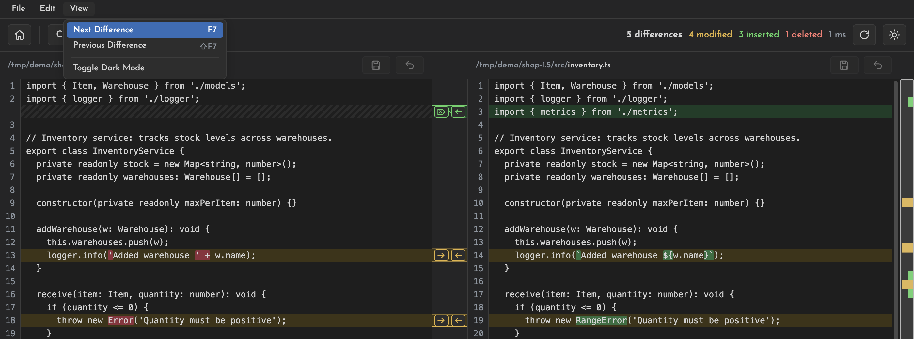

# Installing and running

Delta comes in two forms built from the same code. Pick whichever suits you; they share your list of recent comparisons.

| | Desktop app | Browser version |
|---|---|---|
| What it is | A regular app with its own window | A small local server, used in your web browser |
| Install | Build an installer once (`.dmg`, `.exe`, AppImage) | Nothing to install beyond Node.js |
| Start it | From your Applications folder or Start menu | `start.command` (macOS, Linux) or `start.cmd` (Windows) |
| Best for | Everyday use | Trying Delta, or machines where you'd rather not install apps |

## 1. Prerequisites

- **[Node.js](https://nodejs.org/) 22.12 or newer.** Check with `node --version`. The LTS installer from nodejs.org is fine; Homebrew, nvm and Volta installs work too.
- **Git**, to clone the repository (or download it as a ZIP from GitHub and unzip it).
- macOS, Windows or Linux.

## 2. Get the code

```sh
git clone <this repository's URL> delta
cd delta
```

## 3a. The browser version

Delta's browser version runs a small server on your own computer (`127.0.0.1` only, never on the network) that does the file access, and shows the same interface as the desktop app in your browser.

**Start it:**
- **macOS:** double-click **start.command** in the project folder (or run `./start.command` in Terminal).
- **Windows:** double-click **start.cmd** (or run `start.cmd` in a Command Prompt).
- **Linux:** run `./start.command`.
- **Anywhere:** `npm run web` does the same.

The first start installs Delta's dependencies and builds it, which takes a minute; later starts take a second or two. It also reinstalls or rebuilds by itself after you update the code. Your browser then opens Delta at **http://localhost:5910**; open as many tabs as you like. Delta keeps running in that window: press **Ctrl+C** there, or close the window, to stop it.

**Start with a comparison:** pass two files or two folders.

```sh
./start.command left.txt right.txt
./start.command ~/project-v1 ~/project-v2
```

**Stop or restart it:** press Ctrl+C in its window, or from any terminal:

```sh
./start.command --stop       # stop the running copy
./start.command --restart    # stop it and start again (after updating, say)
```

On Windows use `start.cmd --stop` / `start.cmd --restart`; with npm, `npm run web -- --restart`.

Only one copy runs per port: starting Delta again while it's running (with or without paths) opens the running one in your browser, with the new comparison if you gave one. To use another port, add `--port <number>`.

One thing differs from the desktop app: Cmd/Ctrl+W, T and N stay with the browser.

**Security:** the server listens on your computer only (`127.0.0.1`), never on the network, and accepts file requests only from Delta's own page, so other websites you visit can't reach your files through it. Like any local web app, it trusts programs already running on your computer.



## 3b. The desktop app

First install the build tools (including Electron) into `node_modules/`; this takes a minute or two:

```sh
npm install
```

Electron's app itself (about 100MB) is downloaded the first time you run `npm start` or `npm run dev`.

**Run it straight from the project:**

```sh
npm start        # build into dist/app/ and open Delta
```

(`npm run dev` also opens the desktop app, but it's for working on Delta's code: a development build that reloads as you edit. See [Development](development.md).)

**Or build an installer and install Delta like any other app:**

```sh
npm run dist     # creates installers for your platform in dist/installers/
```

| Platform | What you get | How to install |
|---|---|---|
| macOS | `Delta-<version>-<arch>.dmg` and `.zip` | Open the `.dmg` and drag Delta to Applications |
| Windows | `Delta Setup <version>.exe` and a portable `.exe` | Run the setup program, or run the portable `.exe` directly |
| Linux | `Delta-<version>.AppImage` | `chmod +x Delta-*.AppImage`, then run it |

The installers aren't code-signed, so the first launch needs one extra step:
- **macOS:** right-click Delta in Applications, choose **Open**, then **Open** again. After that it opens normally.
- **Windows:** if SmartScreen appears, choose **More info**, then **Run anyway**.

To build for a particular platform, use `npm run dist:mac`, `dist:win` or `dist:linux` (Windows and macOS installers are best built on those systems).

**Opening a comparison from a terminal:** pass two files or two folders.

```sh
open -a Delta --args left.txt right.txt                 # macOS
"C:\Program Files\Delta\Delta.exe" left.txt right.txt   # Windows (default install location)
./Delta-*.AppImage ./before ./after                     # Linux
```

## Updating

```sh
git pull
```

**Browser version:** start it as usual (or `./start.command --restart` if it's running). It notices the new code, reinstalls dependencies if they changed, and rebuilds itself.

**Desktop app run from the project:** `npm install`, then `npm start` (which rebuilds as it opens).

**Installed desktop app:** there's no automatic update; build a new installer and install it over the old one. Your recent comparisons and settings are kept, since they live in your user settings folder, not in the app.

```sh
npm install      # picks up any changed dependencies
npm run dist     # new installer in dist/installers/
```

- **macOS:** quit Delta, open the new `.dmg` and drag Delta to Applications, choosing **Replace**. The first launch may need right-click > Open again, because each build is a new (unsigned) app.
- **Windows:** quit Delta and run the new `Delta Setup <version>.exe`; it upgrades the existing installation (no need to uninstall). For the portable version, replace the old `.exe` with the new one.
- **Linux:** replace the old AppImage with the new one (and `chmod +x` it).
